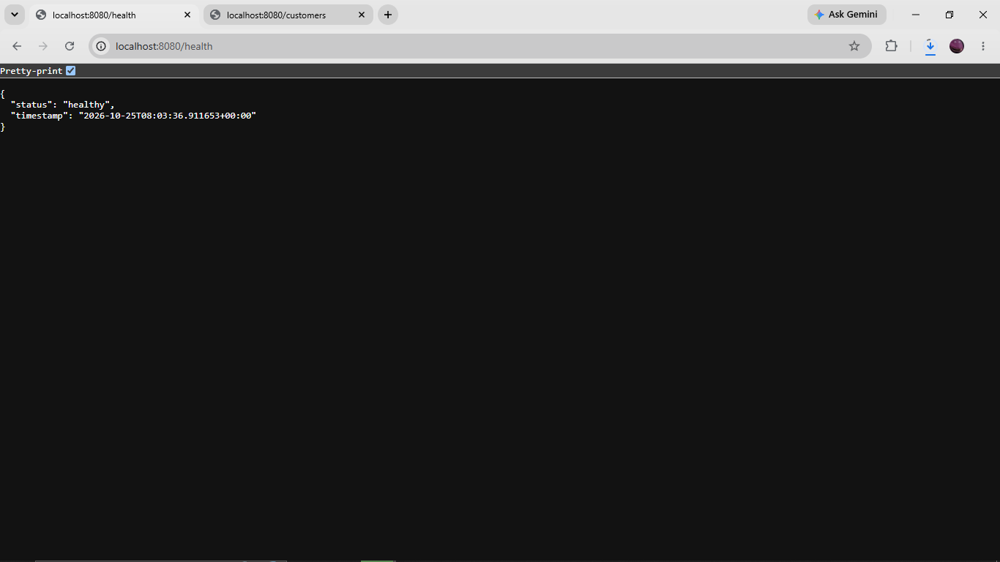
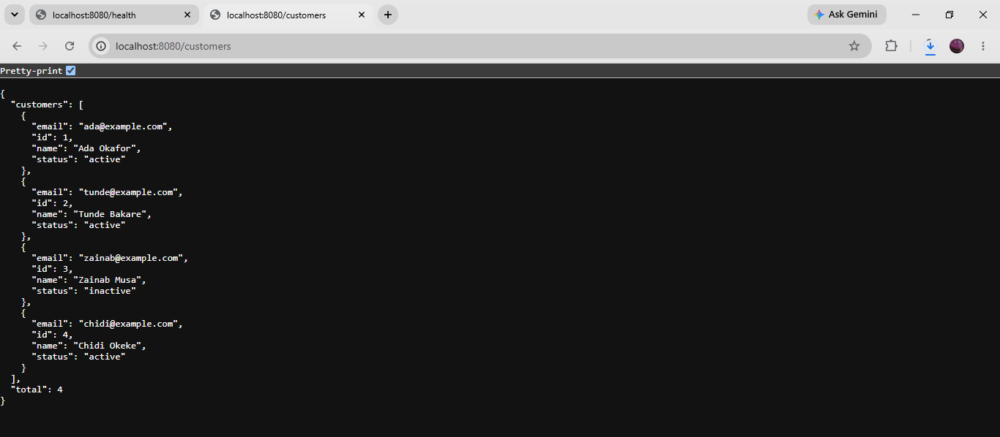

# Ballax Technologies — AWS Cloud Migration Project

## Project Overview

This project demonstrates the migration of a simulated company's customer management application and MySQL database from a local environment to Amazon Web Services (AWS).

The objective was to design and deploy a cloud-based architecture with network isolation, controlled database access, persistent application services, and secure administrative connectivity.

**Project type:** Hands-on cloud engineering simulation  
**AWS Region:** Europe (Stockholm) — `eu-north-1`

## Technologies Used

- **Cloud:** Amazon Web Services (AWS)
- **Networking:** Amazon VPC, subnets, route tables, security groups
- **Compute:** Amazon EC2 (Amazon Linux 2023)
- **Database:** Amazon RDS for MySQL
- **Backend:** Python, Flask, PyMySQL
- **Application server:** Gunicorn
- **Reverse proxy:** Nginx
- **Service management:** systemd
- **Administration:** Linux, SSH, SSH port forwarding
- **Testing:** curl, MySQL/MariaDB client

## Architecture
[View the AWS Architecture Diagram](architecture.md)
The project uses a custom AWS Virtual Private Cloud (VPC) with separate public and private subnets.

| Component | Configuration |
|---|---|
| VPC | `10.0.0.0/24` |
| Public subnet | `10.0.0.0/25` |
| Private subnet | `10.0.0.128/25` |
| EC2 instance | Amazon Linux 2023, `t3.micro` |
| Database | Amazon RDS MySQL, `db.t3.micro` |
| Application port | `127.0.0.1:8000` |
| Nginx proxy | `127.0.0.1:8080` |

### Application Request Flow

1. An administrator establishes an SSH tunnel from their local computer to the EC2 instance.
2. Requests reach Nginx through the tunnel.
3. Nginx forwards requests to Gunicorn.
4. Gunicorn runs the Flask customer management API.
5. Flask establishes encrypted connections to Amazon RDS MySQL.
6. Database results are returned to the client as JSON responses.

The API is intentionally restricted to local interfaces on the EC2 instance and is not publicly exposed.

## Implementation

### 1. AWS Network Infrastructure

Created a custom VPC with separate public and private subnets.

Configured networking and security groups to support administrative access to the EC2 instance and database communication within the AWS environment.

### 2. Database Migration

Created a local MySQL database containing customer records.

Exported the database using `mysqldump`, securely transferred the SQL export to EC2, and imported it into Amazon RDS MySQL.

Verified that the original customer records were preserved following migration.

Created a dedicated database application user with limited permissions rather than using the RDS administrator account for application queries.

### 3. Flask Application Deployment

Developed a REST API using Flask and PyMySQL.

Implemented the following endpoints:

| Method | Endpoint | Description |
|---|---|---|
| GET | `/` | Application information |
| GET | `/health` | Application health response |
| GET | `/customers` | Retrieve customer records |
| GET | `/customers/<id>` | Retrieve a specific customer |
| POST | `/customers` | Create a customer record |

Configured the application to retrieve database connection settings from environment variables rather than hardcoding credentials in source code.

### 4. Gunicorn and systemd

Deployed the Flask application using Gunicorn.

Created and enabled a systemd service to manage the application process and start it automatically when the EC2 instance boots.

### 5. Nginx Reverse Proxy

Installed and configured Nginx to forward HTTP requests to Gunicorn.

Restricted the application and reverse proxy listeners to the EC2 instance's loopback interface.

### 6. Security Measures

Implemented several security controls:

- Restricted inbound SSH access using EC2 security group rules.
- Removed unnecessary inbound HTTP and MySQL rules.
- Kept Amazon RDS inaccessible from the public internet.
- Used a dedicated database account with limited privileges.
- Required SSL for the application database account.
- Stored database credentials in a restricted environment file on EC2.
- Used SSH port forwarding for private application access.
**Note:** The demonstration API does not implement end-user authentication and is not intended for public production exposure.

## Testing and Verification

Successfully verified:

- EC2 connectivity to the RDS MySQL endpoint.

- Database migration and preservation of the original customer records.
- Application database access using the restricted database account.
- Successful HTTP responses through Gunicorn and Nginx.
- Application accessibility through SSH port forwarding.
- Successful creation of an additional customer using an HTTP POST request.
- Persistence of the newly created customer record in RDS.
- Application service status and request logs using systemd and Nginx.

### Deployment Evidence

**API Health Check**

**Customer Database Integration**

## Challenges and Lessons Learned

This project provided practical experience in:

- Designing VPC networking and controlling traffic with security groups.
- Troubleshooting database connectivity and authentication.
- Understanding the difference between a development server and an application server.
- Managing long-running Linux services with systemd.
- Configuring reverse proxies and local-only network listeners.
- Securing credentials and applying least-privilege database permissions.
- Testing a migrated application end to end.

## Future Improvements

Potential improvements include:

- Infrastructure as Code using Terraform.
- Automated deployment through CI/CD.
- Application authentication and authorization.
- HTTPS and a controlled public-facing entry point.
- Improved application logging and database-aware health checks.
- Automated database backup and recovery testing.

## Project Scope

Ballax Technologies is a fictional organization used for this educational cloud migration simulation.

The project demonstrates a working AWS deployment and database migration, rather than a production-ready enterprise system.

