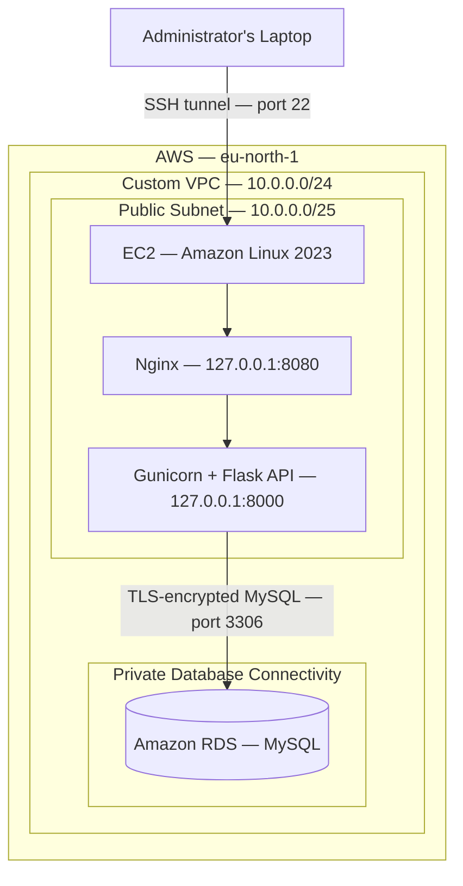

# Ballax Technologies — AWS Architecture

## Architecture Notes

- The EC2 instance provides the application compute environment.
- Nginx and Gunicorn listen only on the EC2 loopback interface.
- SSH port forwarding provides access without exposing the API publicly.
- Amazon RDS is not publicly accessible.
- Security groups restrict network access between components.
- Flask connects to MySQL using a dedicated application database account.

